# Account model: the one written model

Brief: `briefs/account-system-plan-draft.md` (sha 3c4fed78) on `arc/briefs-dancer-rebuild`. Research only:
the Website was read at `claude/journey-matrix` @ 34877de (PR #764 head 028a8b7 plus MATRIX.md), and the admin
repo at `main` @ 3a9ccc6. Prod counts are from read-only SELECTs on `stsdtacfauprzrdebmzg`, 2026-10-15. Counts
only; no personal data was read.

Every screen, routing function and test should be derivable from this file. If code and this file disagree,
the code is wrong. If this file and an owner decision disagree, this file is wrong. Change it first; then
`JOURNEY-GRID.md` and the code follow.

**Status keys.** **BUILT** means it is in the code (file:line). **PARTIAL** means part of the chain is built.
**NOT BUILT** means nothing yet. **DECISION NEEDED** gives a recommended default and the matching `DECISIONS.md`
id. **CONFLICT** means the code contradicts an owner decision.

Paths starting `src/` and `tests/` are in the Website repo. Paths starting `M/` are admin-repo
`supabase/migrations/`. Paths starting `fn/` are admin-repo `supabase/functions/`.

---

## 1. The shape: one login, many sides

This is how Google (one account, many YouTube channels), Slack (one e-mail, many workspaces) and Meta
Business (one Facebook login, many Pages) do it. It is also what the code already does:

- **One login** is one `auth.users` row, keyed by e-mail. There are no passwords: sign-in is an e-mail code
  or a magic link.
- **Many sides.** A *side* is a hat the login can wear: the **dancer side** (one per login) and one
  **organiser side** per organiser page the login owns or manages.
- **Capabilities are not sides.** Admin is a capability of the login. It adds no side, so it is never in
  "Continue as".
- **No stored "active side".** The side being worn is read from the URL: `/app/*` is the dancer side and
  `/account/o?o=<id>` is an organiser side. A reload or a shared link always shows the same side, and there
  is no server state to go stale (BUILT: `switcherItems`, `src/lib/accountRouting.ts:344`).

## 2. Entities

| Entity | Storage (admin repo owns the schema) | Read by the Website through | Status |
|---|---|---|---|
| **Login** (account) | `auth.users`. The sign-up intent is `user_metadata.user_type`, written at `src/pages/Auth.tsx:269-277` | `useAuth` (`src/hooks/useAuth.tsx:72-91`) | BUILT |
| **Dancer profile** (persona) | `dancer_profiles`, one live row per login (`_dancer_profile_id_for_account_v1`). Complete = first name, city, dance role and photo (`profile_complete_v1`, `M/20261109950000_profile_complete_and_email_link_review_v1.sql:340-356`) | `_my_dancer_profile_id_v1` (`src/lib/myPersona.ts:18`), `profile_complete_v1` (`src/hooks/useProfileCompletion.ts:36-50`) | BUILT |
| **Admin-made dancer profile** | A `dancer_profiles` row with no login, matched by e-mail | `claim_my_dancer_profile_v1` on every sign-in (`src/lib/claimMyDancerProfile.ts:27`, called from `src/pages/AuthCallback.tsx:87`) | BUILT |
| **Organiser page** | `entities` plus `entity_members` (owner / manager / contributor) | `organiser_home_v1` (`src/modules/organiser/shared/selfServeApi.ts:76`), which counts owner or manager | BUILT |
| **Organiser access request** | `entity_decision_audit` rows with status open / granted / declined. At most 10 open per user (`M/20261108220000_organiser_access_requests_v1.sql:6-46`) | `list_organiser_access_requests_v1` with scope `mine` (`selfServeApi.ts:86`) | BUILT |
| **Organiser invite** ("team invite" link `/invite/<token>`) | `organiser_invites`: sha256 of the token only, 7-day expiry, single use, one open per organiser; 10 failed redeems per hour (`M/20261110120000_organiser_invite_tokens_v1.sql:62-91`). Redeeming makes the redeemer an owner | `redeem_organiser_invite_v1` (`src/modules/admin-organisers/adminApi.ts:97`) | BUILT |
| **Team membership added by an owner** | `entity_members`, added directly by e-mail or profile. There is no accept step (`organiser_team_set_member_v1`, `organiser_team_add_member_by_profile_v1`) | `src/modules/organiser/shared/teamRpcApi.ts:16-50` | BUILT |
| **Dancer invite** | `dancer_invites`: sha256 only, 7-day expiry, single use, **bound to the e-mail** (`email_mismatch`). Issuing it also allowlists the e-mail (`M/20261121180000_dancer_invites_v1.sql:8-17,97,264-336`). The link sent is `<origin>/join/<token>` (`fn/dancer-invite-send/handler.ts:9-11`) | **No `/join` route exists on the Website** | PARTIAL (back end deployed, no front end) |
| **Consent record** | `member_consents` (user, kind, version, accepted_at); `accept_terms_v1` (`M/20261121150000_member_consents_export_extras_v1.sql:37-85`) | Nothing calls it. Prod has 0 rows | NOT BUILT on the Website |
| **Erase request (grace)** | `account_erase_requests`, due at request + 30 days (`M/20261121100000_account_erase_grace_requests_v1.sql:60-75`); cron `account-erase-due` at 05:23 daily | Only `erase_requested_at` is parsed (`src/modules/dancer-app/api/rpc.ts:106`) | **CONFLICT** with owner decision O4 (section 6) |
| **Admin capability** | `admin_users`, read by `is_admin()` | `admin_is_admin` (`adminApi.ts:19`, `src/hooks/useIsAdmin.ts`), used only on `/admin/organisers` | BUILT (no routing role) |

## 3. Account state

A login's state is a **tuple**, not one enum. Every routing function in `src/lib/accountRouting.ts` reads a
part of it. The tuple is what the grid's `state` column names.

| Axis | Values | Computed by | Status |
|---|---|---|---|
| **A. Session** | `out` (signed out) / `code_sent` (code e-mailed, not entered; page state only, `Auth.tsx:90`) / `in` / `unavailable` (cannot verify the session, `AuthGuard.tsx:127-157`) | `useAuth` `authStatus` | BUILT |
| **B. Login lifecycle** | `none` (no `auth.users` row) / `unconfirmed` (row exists, code never entered) / `active` / `erased` (row deleted) | Supabase Auth; `unconfirmed-account-purge` cron at 03:40 erases logins unconfirmed for 7 days that hold only an untouched stub (`M/20261121190000_unconfirmed_account_purge_v1.sql:1-40,474`) | BUILT |
| **C. Dancer stage** | `none` (no live row, or archived) / `incomplete` / `complete` / plus `loading` and `error` while reading | `useProfileCompletion` (`src/hooks/useProfileCompletion.ts:77-82`); archived counts as `none` (`accountRouting.ts:73,131-133`) | BUILT |
| **D. Dancer visibility** | `shown` / `hidden` (`my_profile_disable_v1`) | `src/pages/AccountSettings.tsx` "Hide profile" | BUILT |
| **E. Organiser sides** | `0` / `1` / `2+` | `organiser_home_v1` → `profileSides` (`accountRouting.ts:278-304`) | BUILT |
| **F. Open access requests** | `0` / `1+` | `list_organiser_access_requests_v1` | BUILT |
| **G. Organiser intent** | `user_type` = `organiser` or not | `hasOrganiserIntent` (`accountRouting.ts:213`) | BUILT |
| **H. Admin** | yes / no | `is_admin()` | BUILT (adds no side) |
| **I. Dancer-area gate** | `allowed` / `closed` / `error` (error counts as closed) | `dancer_area_gate_v1` via `useDancerArea` (`src/modules/dancer-app/gate/useDancerArea.ts:368-384`); flag `app_feature_flags.dancer_area_open` (prod: **true** since 2026-10-15 14:05) | BUILT |

### Named states (the buckets JOURNEY-GRID uses)

These are the MATRIX.md WHO buckets, renamed to stable ids. They are combinations of the axes above;
"Prod" is accounts on 2026-10-15 (20 logins in total).

| State id | Axes | Prod | Lands after sign-in (`signInLanding`, `accountRouting.ts:322-335`) | Status |
|---|---|---|---|---|
| `S-NEW` | A=out, B=none | every visitor | n/a (signs up) | BUILT |
| `S-UNCONF` | B=unconfirmed (left on the code step) | **6** (never signed in) | Entering a code later finishes sign-up; after 7 days the purge erases it | BUILT |
| `S-EMPTY` | C=none, E=0, H=no (archived stub) | 0 (2 logins have no dancer row; both are admins) | `/` today. **Owner decision O5: dancer setup** | **CONFLICT** (NOT BUILT: M44) |
| `S-DANCER-PART` | C=incomplete, E=0 | 7 (8 incomplete logins in total, 1 with an organiser) | `/app/welcome` at the first missing card; with intent G, `/app/welcome?returnTo=/account/o` (`:297-300`) | BUILT |
| `S-DANCER` | C=complete, E=0, F=0, G=no | about 5 | `/app/home` | BUILT |
| `S-DANCER-INTENT` | C=complete, E=0, F=0, G=organiser | 2 | `/account/o` claim screen (owner decision O1, F2 b) | BUILT |
| `S-REQUEST` | C=any, E=0, F=1+ | 1 | One side (dancer); intent does not fire | BUILT |
| `S-ORG1` | E=1 plus a dancer side | 4 (1 with an UNFINISHED dancer) | `/account/continue` "Continue as" (2 sides) | BUILT |
| `S-ORG2` | E=2+ plus a dancer side | 0 | `/account/continue` with one button per organiser (`?o=`) (owner decision O2) | BUILT |
| `S-ORG-ONLY` | E>=1, C=none | 0 | `/account/o`, then the gate shows Finish (`no_profile`) | BUILT (unwalked) |
| `S-ADMIN-ONLY` | H=yes, C=none, E=0 | 2 | `/` (0 sides) | BUILT. DECISION NEEDED D2 |
| `S-ADMIN-DANCER` | H=yes plus a dancer | 2 (both also S-ORG1) | as the non-admin state | BUILT |
| `S-ERASED` | B=erased | 0 | Signing up again creates a brand-new login and person (owner decision O4) | BUILT (nothing to restore). Unwalked |

## 4. Transitions

Each row: the trigger, what runs it, and the end the person sees. `T-*` ids are referenced from the grid.

| Id | From → To | Trigger | Runs | Person sees | Status |
|---|---|---|---|---|---|
| T-SIGNUP | S-NEW → S-UNCONF | Sign-up form (role, details, e-mail) | `signInWithOtp` with metadata (`Auth.tsx:259-279`); `hook_before_user_created_v2` decides (see 5.1) | 8-digit code screen (`MagicLinkConfirmation.tsx`) | BUILT |
| T-SIGNUP-REFUSED | S-NEW → S-NEW | Hook returns 403 (not allowlisted while the area is closed, or a blocked domain) | v2 hook (`M/20261121170000_signup_hook_v2_blocked_domains.sql:165-223`) | Invite-only copy plus WhatsApp link (`Auth.tsx:297-299`) | BUILT |
| T-CONFIRM | S-UNCONF → stage C | Correct code, or magic link | `verifyOtp` (`MagicLinkConfirmation.tsx:51`), then `/auth/callback`: self-claim, fill stub from metadata (`AuthCallback.tsx:87,201-240`), `routeOnwards` (`:135-160`) | The returnTo, else `signInLanding` | BUILT |
| T-SIGNIN | out → in | Sign-in form, e-mail known | `signInWithOtp({shouldCreateUser:false})` | Code screen; then as T-CONFIRM | BUILT |
| T-SIGNIN-UNKNOWN | out → sign-up | Sign-in with an unknown e-mail | 422 `otp_disabled` (`Auth.tsx:290-294`) | Form switches to sign-up, e-mail kept | BUILT |
| T-CODE-WRONG | code_sent → code_sent | Wrong or expired code | `MagicLinkConfirmation.tsx:56-63` | Inline error, box cleared | BUILT. **No attempt cap on the client**; the server-side cap is Supabase's default (GAPS G-S1) |
| T-LINK-EXPIRED | → out | Stale link, or no session after 9 s | `AuthCallback.tsx:279-295` | `/auth?mode=signin&callbackError=expired&returnTo=…` | BUILT. `userType` is not kept (MATRIX M08) |
| T-ONBOARD | DANCER-PART → DANCER | Finishes the cards | `/finish-profile` → `/app/welcome?returnTo` → end (`onboardingEnd`, `accountRouting.ts:223`) | The returnTo, else `/app/home` | BUILT |
| T-CLAIM | DANCER → ORG1 | `claim_organiser_v1`: e-mail equals the organiser's contact e-mail and the session was mailbox-proven (`M/20261108210000_…:18-60`) | `PublicClaimCard` / organiser onboarding | "This is your page" | BUILT |
| T-REQUEST | DANCER → REQUEST | Request access | `request_organiser_access_v1` | Open-request screen | BUILT |
| T-GRANT / T-DECLINE | REQUEST → ORG1 / DANCER | An owner or admin resolves it (only an admin can grant owner) | `resolve_organiser_access_request_v1` | Next load shows the organiser / the decline | BUILT. No e-mail to the requester (GAPS G-O4) |
| T-CREATE-ORG | DANCER → ORG1 | Create a new organiser page | `create_organiser_profile_v1` | `/account/o` Home | BUILT |
| T-INVITE-REDEEM | any complete → ORGn+1 | `/invite/<token>` | `redeem_organiser_invite_v1`; bearer, no e-mail binding (`M/20261110120000_…:26-49`) | `/account/o` (`InviteRedeemPage.tsx:113-118`) | BUILT. The card does not yet name who is joining: owner decision O3, **NOT BUILT** |
| T-TEAM-ADD | any → ORGn+1 | An owner adds the person by e-mail or profile | `organiser_team_set_member_v1` / `_add_member_by_profile_v1` | Nothing, until their next sign-in shows the side | BUILT. No notification (GAPS G-O4) |
| T-TEAM-REMOVE | ORGn → ORGn-1 | An owner removes the person | `remove_organiser_member_v1` | Side gone on next load | BUILT |
| T-DANCER-INVITE | NEW / DANCER-PART (admin-made profile) → DANCER | `/join/<token>` e-mail | Owner decision O6: dancer link plus claim. Back end `peek_` / `redeem_dancer_invite_v1` (e-mail-bound) | — | **NOT BUILT** (no route) |
| T-SWITCH | side → side | "Continue as" / switch sheet | `ContinueAsPage.tsx:15-55`, `switcherItems` | The chosen side, ticked | BUILT |
| T-SIGNOUT | in → out | Any of 6 sign-out buttons (all go to `/`) | `useAuth().signOut` (`useAuth.tsx:136-176`): global scope, local fallback | Site home | PARTIAL: **person-scoped storage survives** (MATRIX M76, DECISION NEEDED D1) |
| T-HIDE / T-SHOW | shown ↔ hidden | Account settings | `my_profile_disable_v1` | Profile off the public site | BUILT |
| T-EXPORT | in → in | "Download my data" | `my_account_export_v1` (`src/lib/accountSettings.ts:33-50`) | A JSON file | BUILT. `my_account_export_extras_v1` is not called (GAPS G-P3) |
| T-ERASE | active → erased | `/account/settings/delete`, type DELETE | Check `my_account_erase_check_v1` (refuses `admin_account`, `sole_organiser_owner`), then edge fn `account-erase` (deployed v1): R2 files, then `my_account_erase_v1` | Signed out, `/account/deleted` (`AccountSettings.tsx:364-377`) | BUILT, matches owner decision O4 |
| T-ERASE-GRACE | active → erase requested → erased after 30 days | `my_account_erase_request_v1` | Cron `account-erase-due` | E-mails with a cancel link to `/app/options/data/erase?cancel=` (a Website route that does not exist) | **CONFLICT** with O4. Deployed and live but unused (0 rows). PLAN PR-2 retires it |
| T-UNCONF-PURGE | UNCONF → erased | 7 days unconfirmed, untouched stub | cron `unconfirmed-account-purge` | Nothing | BUILT |
| T-EMAIL-CHANGE | e-mail A → B | Account settings | `supabase.auth.updateUser({email})`, secure change (both links) (`AccountSettings.tsx:132-205`) | "Open both links…" | BUILT. Unwalked; the claim/invite e-mail checks follow the new e-mail |
| T-ADMIN-PROVISION | none → active (pre-confirmed) | Admin | `fn/admin-provision-person` (allowlist plus `createUser`) | — | Not deployed (`config.toml:30-33`; absent from the deployed function list) |

## 5. Rules that hold across every state

1. **Fail closed.** If a gate read fails, it gates (`dancerGate`, `accountRouting.ts:141-145`). If the area
   gate read fails, the area counts as closed. If the sign-up hook cannot read the area flag, sign-up counts
   as closed. BUILT.
2. **returnTo is one sanitiser.** `sanitizeReturnTo` (`src/lib/authRouting.ts:8-31`) is used everywhere;
   onboarding also drops its own paths (`onwardReturnTo`, `accountRouting.ts:195-206`). BUILT.
3. **Intent lives in the URL or the login, never only in storage.** It is carried as `returnTo`, `?claim=1`
   or `/invite/<t>`, and `user_type` is the backstop. BUILT. Exception: `pending_profile_role` and
   `auth_pending_return_to` in localStorage (D1 makes sign-out clear them).
4. **The dancer side comes first.** Every organiser action needs a complete dancer profile
   (`_require_complete_dancer_profile_v1`, `M/20261111100000_…:79`; admins exempt). BUILT.
5. **One person, one login.** Erase is final and immediate, and signing up again makes a new person (O4).
   Nothing is restored, merged or linked by e-mail, except an admin-made dancer profile that was never owned
   (self-claim at sign-in).
6. **Invites.** A team (organiser) invite is a bearer link: whoever is signed in joins, and the card names who
   (O3). A dancer invite is e-mail-bound (back end). The two differ on purpose: a dancer invite hands over a
   person's identity, while a team invite hands over a seat.

### 5.1 The sign-up door

Sign-up passes through `hook_before_user_created_v2`:

- The allowlist always passes.
- If the dancer area is closed, only the allowlist passes.
- If the area is open, everyone passes except blocked domains.

**Which hook is configured in the dashboard cannot be read from SQL** (the runbook says v1 until switched). The
area flag is true in prod now, so the live behaviour depends on that dashboard setting. GAPS G-R1.

## 6. Owner decisions (binding, 2026-10-15) and where they stand

| Id | Decision | State |
|---|---|---|
| O1 | Organiser-intent finished dancer → organiser claim screen | BUILT `signInLanding` (`accountRouting.ts:322-335`), J:organiser-link-closed-tab-after-required |
| O2 | 2+ organisers → "Continue as" list | BUILT `profileSides`; R:two-orgs+dancer |
| O3 | Team invite opened by a different signed-in person: the bearer joins, the card names who, "Not you? Sign out" | Bearer is BUILT. The card text is **NOT BUILT** (PLAN PR-3) |
| O4 | No deletion grace: erase now; signing up again makes a new person | The Website is BUILT immediate. The admin grace path is **deployed and contradicts it** (PLAN PR-2 retires it) |
| O5 | Empty account → dancer setup | **NOT BUILT** (`signInLanding` sends 0 sides to `/`). PLAN PR-3 |
| O6 | Dancer invite e-mail → dancer link plus claim | **NOT BUILT**. PLAN PR-4 adds `/join/:token` |
| O7 | The e-mail code is tested on a Supabase branch or test project that reads the OTP | **NOT BUILT** (only fakes today). PLAN PR-5 |
| O8 | Every grid row a real account can hit is tested and walked before merge | PARTIAL (19 J rows, 7 R walks). PLAN PR-1 adds the CI check |

## 7. State diagram

```mermaid
stateDiagram-v2
    [*] --> NEW
    NEW --> UNCONF: T-SIGNUP (hook allows)
    NEW --> NEW: T-SIGNUP-REFUSED (403)
    UNCONF --> ERASED: T-UNCONF-PURGE (7 days)
    UNCONF --> DANCER_PART: T-CONFIRM (code / link)
    UNCONF --> DANCER: T-CONFIRM + self-claim of a complete admin-made profile
    EMPTY --> DANCER_PART: O5 dancer setup (NOT BUILT; today lands on /)
    DANCER_PART --> DANCER: T-ONBOARD
    DANCER --> DANCER_INTENT: user_type = organiser (no org, no request)
    DANCER --> REQUEST: T-REQUEST
    REQUEST --> ORG1: T-GRANT
    REQUEST --> DANCER: T-DECLINE
    DANCER --> ORG1: T-CLAIM / T-CREATE-ORG / T-INVITE-REDEEM / T-TEAM-ADD
    DANCER_INTENT --> ORG1: T-CLAIM / T-CREATE-ORG
    ORG1 --> ORG2: another claim / invite / team add
    ORG2 --> ORG1: T-TEAM-REMOVE
    ORG1 --> DANCER: T-TEAM-REMOVE
    DANCER --> ERASED: T-ERASE (immediate)
    DANCER_PART --> ERASED: T-ERASE
    ORG1 --> ERASED: T-ERASE (refused if sole owner)
    ERASED --> NEW: re-sign-up = new person (O4)
    note right of ORG1
      Admin is a capability, not a state:
      ADMIN_ONLY lands on /, admin + dancer
      routes as the non-admin state.
    end note
```

Session axis (independent of the above):

```mermaid
stateDiagram-v2
    [*] --> out
    out --> code_sent: send code
    code_sent --> code_sent: wrong code / resend (30 s cooldown)
    code_sent --> in: correct code / magic link
    code_sent --> out: reload (page state lost) / link expired
    in --> out: T-SIGNOUT (global; local on error)
    in --> unavailable: cannot verify session
    unavailable --> in: retry
    in --> out: other tab signs out (auth-js sync; MATRIX M78)
```

## 8. Who may switch to what

| From | May open | Via | Rule |
|---|---|---|---|
| Any signed-in login with a dancer row | The dancer side (`/app/*`) | Switch sheet, "Continue as" | If the area gate is closed, `/account/dancer`; incomplete goes to `/app/welcome` (`dancerSidePath`, `:269`) |
| Owner or manager of organiser X | Organiser X (`/account/o?o=X`) | Switch sheet, "Continue as" | `organiser_home_v1` membership. **Contributor**: not counted as a side (`organiser_home_v1` counts owner or manager only). DECISION NEEDED D5 |
| Admin | `/admin/organisers` | URL only | `AdminGate`; adds no side |
| Nobody | Another login's side | — | There is no "view as" or impersonation. Recommended: keep it that way |
