# People arc S2 -- the dancer world -- handover

- Branch: `claude/people-dancer-world` (from `main` 7cfedc6). Brief: `briefs/PEOPLE-S2-dancer-world-brief.md` on
  `brief/people-arc` (sha 548a2b8c).
- Content commit: `908654d`; the head is the handover commit right after it
  (`git log -1 origin/claude/people-dancer-world`). PR: #986 (opened by the repo bot on the first push; title and body are this worker's).
- Design record: [`docs/design/people-s2-dancer-world.md`](../../design/people-s2-dancer-world.md).
- Behind `flags.personWorlds` (`VITE_ENABLE_PERSON_WORLDS=true`), default OFF. OFF = today's page: the only
  change on that path is `useAuth()` also reading `authStatus`, which renders nothing (matrix "flag OFF" rows).
  The embedded Dancing tab of `/people/:id` stays today's page with the flag ON too.

## Files

| File | What |
|---|---|
| `src/pages/DancerProfile.tsx` (seam) | flag ON and not embedded -> `GlobalLayout` + `DancerWorldPage`; the role bar read is skipped then |
| `src/modules/person-page/worlds/dancer/model.ts` | pure: `dancerCard`, `lowerHalf`, `previewOf`, `nextAppearance`, `socialsThisWeek`, `worldRoles`, copy |
| `.../worlds/dancer/useDancerLower.ts` | roles (`usePersonSnapshot`), teacher / DJ timeline, this week's socials (`resolveCanonicalCity` + `getCalendarEvents`) |
| `.../worlds/dancer/DancerWorld.tsx` | the teal card, contacts, lower half, invite |
| `.../worlds/dancer/DancerWorldPage.tsx` | the dancer ground + `PersonFrame` + `DancerWorld` |
| `.../worlds/dancer/__tests__/dancerWorld.matrix.test.tsx` | 77 cases: shapes x lower half x flag ON/OFF |
| `docs/people-arc/s2/capture.mjs`, `checks.json`, `shots/` | the browser walk on prod data + Design Gate 4 checks |

No file in `frame/`, `facts/`, `worlds/tokens.ts`, `wall/` or `src/modules/dancer-app/` changed.

## Shapes (prod, read-only survey 2026-10-23, counts only)

171 live dancer rows: 114 photo, 110 city (London 83, Madrid 22, 5 other cities with 1 each, 61 none), 15 with
languages (codes and English names), 19 nationality (all 2-letter codes), 2 bio, 67 with a social, 35 dance role
(Leader 19, Follower 11, Lead and Follow 5), 3 long names, 45 with no first name. Other worlds
(`get_public_person_roles_v1` + `get_profile_event_timeline_v2`, upcoming = not started): dancer only 27;
teacher+dancer 14 dated / 22 not; teacher+DJ+dancer 10 both dated, 3 teacher dated, 1 DJ dated, 11 none;
DJ+dancer 3 dated / 7 not. This week's
calendar: London 30 parties, Madrid only a festival. Dancer area gate: open.

| Shape | Profile | Lower half | Tabs y | 390 | 360 |
|---|---|---|---|---|---|
| thin (no photo, city, languages, role) + far teacher class | `carol-y-raul` | preview | 166 | 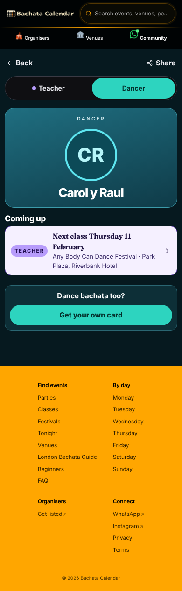 | 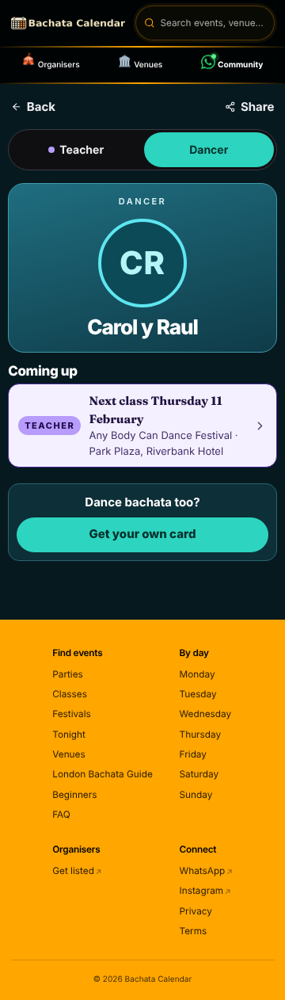 |
| photo + London + role, dancer only | `leoncio` | London socials | - | 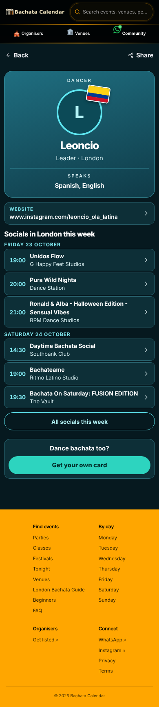 | 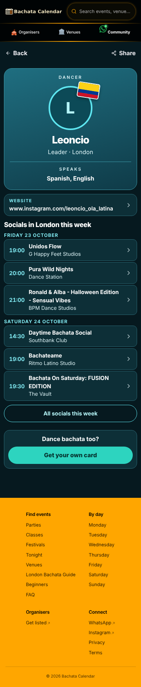 |
| languages + nationality | `chloe-poyiatz` | socials | 166 | 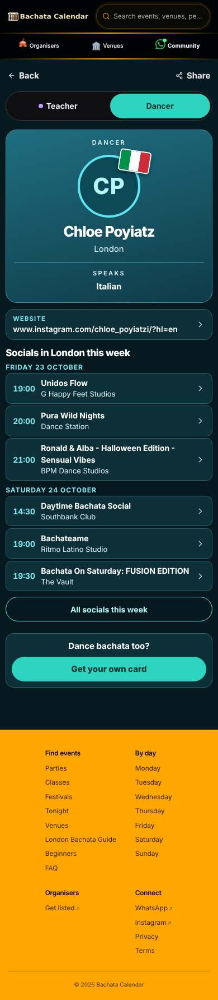 | 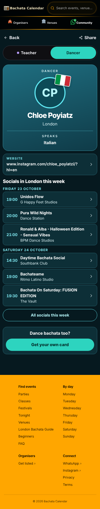 |
| long name | `llf-malva-marina-montenegro` | Madrid socials (empty) | 166 | 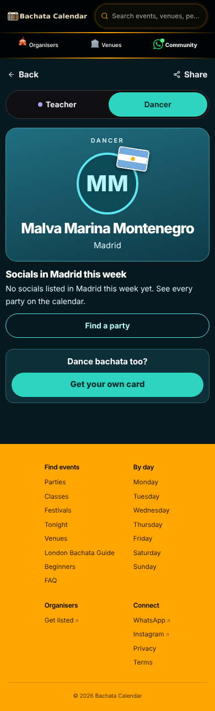 | 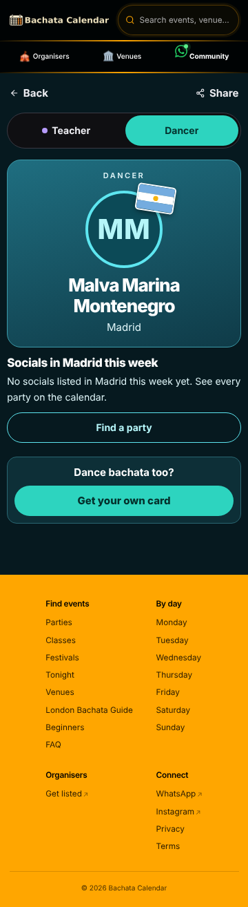 |
| one name, photo | `alfredo-andrea` | preview | 166 | 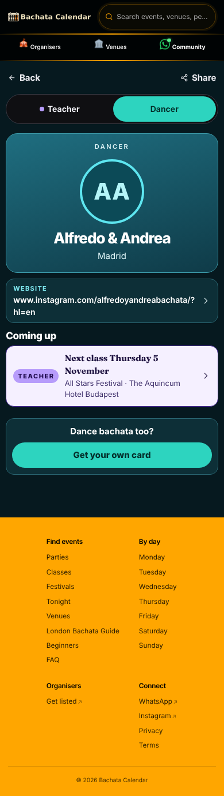 | 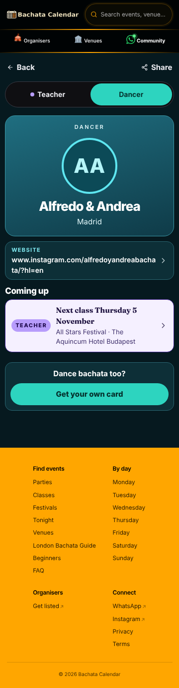 |
| instagram contact | `unclaimed-8395fee2` | socials | - | 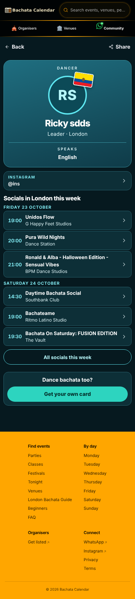 | 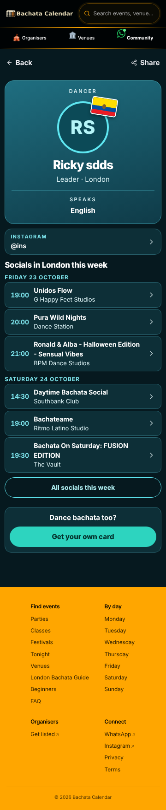 |
| no first name, Madrid | `aitor-angelica-tbf` | Madrid empty state | 166 | 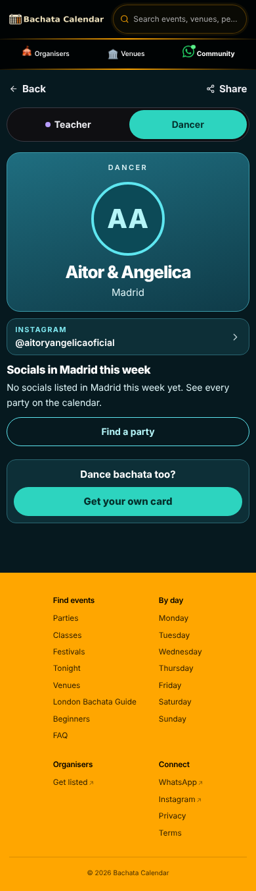 | 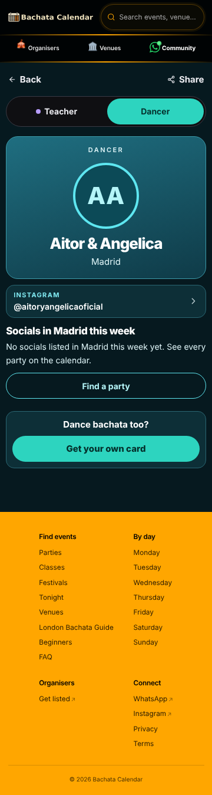 |
| teacher with a class | `alex-boneva` | preview "Next class Thursday 29 October" | 166 | 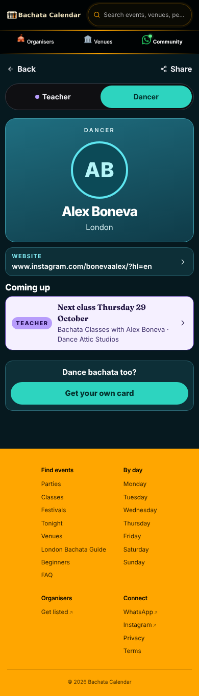 |  |
| teacher without a date | `aurora` | socials | 166 | 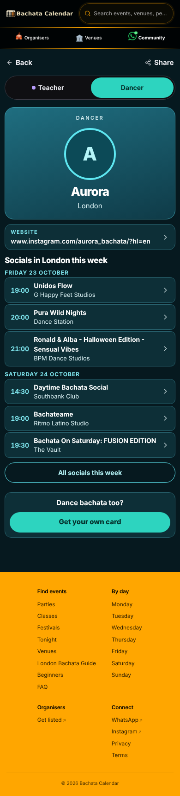 | 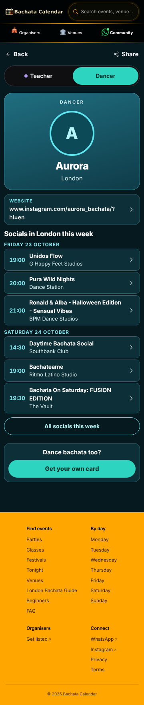 |
| DJ with a gig | `elias` | preview "Next gig Friday 6 November" | 166 | 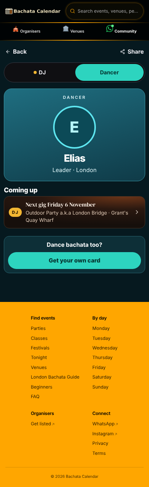 | 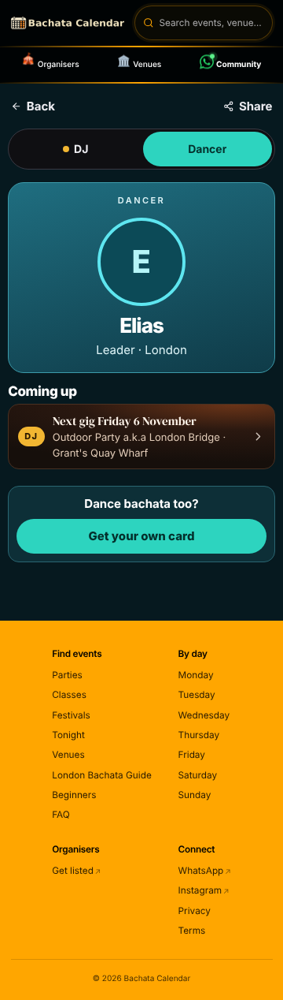 |
| has a bio | `unclaimed-797fab23` | socials | - | 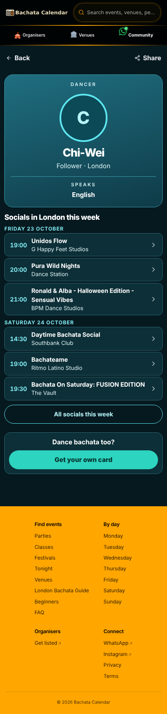 | 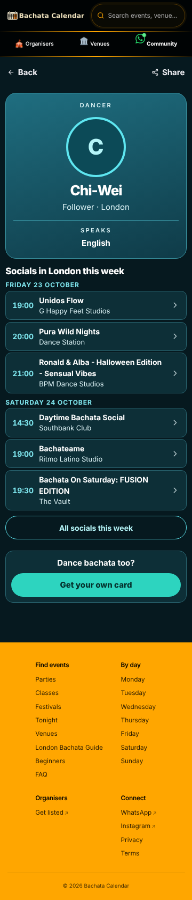 |

Every render: lowest contrast 5.06, no tap under 44px, nothing clipped, no sideways scroll, the invite button
present (`checks.json`). A truly nameless row (no display name) is covered by the matrix test only.

## Brief step 3 (dancer-app `languageName(s)` / `cityOnly` -> `@/lib/languageNames` / `facts.cityLabel`): BLOCKED

Changing any file under `src/modules/dancer-app/` makes this a dancer-area PR (`check-dancer-area-isolation.mjs`
rule a): every other changed file must then be a seam, a test, or under a doc prefix. This PR's world lives in
`src/modules/person-page/worlds/dancer/*.ts(x)` (4 files) and `docs/design/people-s2-dancer-world.md`, none of
which is a seam, so the same PR cannot also touch dancer-app. The world itself uses `facts.languageLine` and
`facts.cityLabel` on the raw values (no dancer-app copy is on the flag-ON path). What unblocks it: a follow-up
PR that changes ONLY `src/modules/dancer-app/public-page/model.ts` (+ its tests), importing `@/lib/languageNames`
and `@/modules/person-page/facts` (dancer-app may import outside its folder; rule b only forbids the legacy
screens). No seam change needed for that.

## Brief step 4 (bio)

`model.bio` is still not shown: the reference card has no place for it (2 live dancers have one). Owner call.

## Needs S3/frame

1. D9 history Back: the frame gets `backHref="/dancers"`; the "came from -> history back" rule is S3's.
2. `useDjPageFonts()` (DM Serif Display) on a page that shows a DJ preview: today the preview's title falls
   back to Georgia. Either the frame loads it or `Avatar`-like shared code exposes it.
3. A time label ("21:00") in `facts/`, so the socials rows can lead with the time like the reference.
4. `Avatar` takes the photo URL as given: the world passes a CDN-resized URL (`optimizedImageUrl`, 224px). If
   S3 moves resizing into `Avatar`, the world should pass the raw URL.
5. The main area is stretched to the screen height by `GlobalLayout`, so short pages keep a band of ground
   above the footer (the reference brings the footer up). Not a frame file; flagging it for whoever owns it.

## Preview / flag

The Vercel API is blocked from this sandbox (proxy refuses api.vercel.com), so the preview env var could not be
set: **needs owner: Vercel token**. To see the world on this branch's preview, add the Preview environment
variable `VITE_ENABLE_PERSON_WORLDS=true` scoped to the git branch `claude/people-dancer-world`, then redeploy
the branch's latest preview (Vite reads it at build time). Without it the preview shows today's page.

## Bugs the walk caught (fixed, with tests)

- Linked profiles showed no tabs and no "Next class": the roles read used the canonical row id, not the
  route-resolved person id. Test "reads the roles of the ROUTE-resolved person" is red on the old line, green now.
- A Madrid festival (one row per day) filled London's and Madrid's "socials": festival rows are left out
  (`isFestivalByFormat`).

## Not verified

- Real photos: the media host is blocked from the sandbox, so every photo fell back to initials in the walk.
- The Vercel preview, real phones, the live site.
- `nextAppearance` treats `get_profile_event_timeline_v2.event_start_time` as a UTC instant (as `facts.londonDayOf`
  and the hub do); not re-proved against a BST/GMT edge on prod.

## S2b: the dancer world in the shared shell, wall-clock gig dates, socials times (2026-10-23)

Brief: `briefs/PEOPLE-S2b-continuation-brief.md` on `brief/people-arc` (sha 339572c9). First step: a merge (not a
rebase) of `origin/claude/people-dj-world` (b62020f), clean, no S3 file touched. Head = `git log -1
origin/claude/people-dancer-world` (this doc rides the last commit). Design record: the S2b section of
[`docs/design/people-s2-dancer-world.md`](../../design/people-s2-dancer-world.md).

### Per item

| Item | Change |
|---|---|
| 1 shell | `DancerWorldPage` renders `<WorldPage world="dancer">` straight around `PersonFrame`; its own `max-w-xl px-4 pb-10 pt-3` wrapper and ground div are gone. NEW `DancerWorldLoading` / `DancerWorldMissing` (same shell; "Back to Dancers" 44px) for the flag-ON loading (dancer read OR slug resolve in flight) and not-found states. `DancerProfile` no longer wraps the world in its own `GlobalLayout`; breadcrumbs = `buildBreadcrumbs('dancer.detail', ...)` |
| 2 next gig / class | `nextAppearance`: future check = `londonWallClockToInstant(stamp) >= now`, day check `facts.wallDayOf`; `previewOf` labels with `facts.gigDateLabel`. Matrix rows: 23:30 summer gig (Saturday 10 July, not Sunday 11), winter gig, a summer gig that started an hour ago (past), a past gig, none |
| 3 socials times | `SocialRow.time = facts.timeLabel(occurrence_starts_at)`; the row leads with it (14px bold accent). Midnight = no time |
| 4 empty-state button | "Find a party" -> `/parties` (was "See all parties"), read from `djWorldView(...)`'s `emptyAction` so there is ONE source; `SOCIALS_COPY.allEmpty` deleted. The muted line above it stays the socials-specific copy |
| 5 D13 footer | from the shell (`fitContent`); no own min height. Measured 54px content-to-footer on every shape |
| 6 D8' invite | unchanged: on every shape (signed out). Signed-in viewers still get none (S2 rule; the DJ world shows it always -- owner call if the two should match) |

Tests (red first: 36 failed on the merged base 3ff4996 + the guard's dancer row): `dancerWorld.matrix.test.tsx`
(wall-clock rows, socials time, wording-is-the-DJ-world's, "one shell for every state" x 8 shapes + loading + not
found, rendered time first). `worldShellGuard.test.ts` (S3's) now covers `DancerWorldPage.tsx` and was red before.
Mutation: a `px-4 pt-3` div put back around `PersonFrame` -> 9 red.

### Frame box per shape (390x844 / 360x800, prod data, flag ON, same build as the DJ reference)

All 11 S2 shapes (carol-y-raul, leoncio, chloe-poyiatz, llf-malva-marina-montenegro, alfredo-andrea,
unclaimed-8395fee2, aitor-angelica-tbf, alex-boneva, aurora, elias, unclaimed-797fab23): **Back L10 T113, bar W
370 / 340**, content-to-footer 54. DJ reference `papacito` in the same build: L10 T113, 370 / 340, 54 -- equal, and
equal to the S3 handover. Tabs y 163 on every two-role shape (S2: 166). Lowest contrast 5.06, no tap under 44px,
0 clipped, no sideways scroll (`checks.json`, `shots/`).

Walk note: the sandbox's own `VITE_SUPABASE_*` point at a non-prod project, so the walk build used prod's public
anon key + URL (read-only), `VITE_ENABLE_PERSON_WORLDS=true` and `VITE_ENABLE_TEACHER_DETAIL=true` /
`VITE_ENABLE_TEACHERS_DIRECTORY=true` (without the teacher flag, teacher roles drop out of the tabs: it is a
build-time flag). The local SSR server needs `NODE_USE_ENV_PROXY=1` to reach Supabase from this sandbox.

### Needs frame (not mine to edit)

1. The D12 button wording lives inline in `worlds/dj/model.ts`; the dancer world reads it through `djWorldView`.
   A `NO_DATES_ACTION` constant in `facts/` that both worlds import would be cleaner.
2. Still open from S2: the DJ preview on a dancer page has no DM Serif Display (`useDjPageFonts` is called by
   `DjWorld`, not by the dancer preview).

### Not verified (S2b)

- Real photos (media host blocked), the Vercel preview (no token: needs owner), a real phone, 1280 width.
- The flag-OFF page in a browser (unit-tested; the OFF path is unchanged).
- The `/code-review` pass (the owner types it).
- Prod shape counts were not re-run (S2's survey of this morning stands).
- `check:doc-weight`, `check:seo`, lighthouse: need a live preview.

## S2 critique: independent design critique + one fix pass (2026-10-23)

Brief: `briefs/PEOPLE-S2-critique-brief.md` on `brief/people-arc` (sha d1b2953a). Critic: a fresh worker. Critique
(ordered fix list, verdicts): [`docs/design/people-s2-critique.md`](../../design/people-s2-critique.md); numbers in
the design record's "S2 critique" section. Head = `git log -1 origin/claude/people-dancer-world` (this doc rides
the last commit).

### What changed

| Item | Change |
|---|---|
| D8'' invite, ONE rule | NEW `facts.showsJoinInvite(user)`: hidden for a signed-in visitor, shown to every signed-out one (anonymous guest = signed out), from the first paint (no wait for auth). DJ world: `DjWorldInput.viewer` (`useAuth().user` from `DJProfile`), `invite` nullable, `DjWorld` renders it only when set. Dancer: `DancerProfile` uses the same rule (its `useAuth()` line is main's again: `authStatus` no longer read) |
| D12 action, ONE constant | NEW `facts.FIND_A_PARTY` `{ label: 'Find a party', href: '/parties' }`; `djWorldView`'s `emptyAction` spreads it; the dancer's `PARTY_ACTION` is it (no more `djWorldView(...)` call to borrow the words) |
| DJ serif in the dancer page | `DancerWorld` mounts the ref-counted `useDjPageFonts` while a DJ preview is on screen |
| Layout shift | `DancerWorldLoading` = bar + `DancerWorldSkeleton` (card 233, a week of socials, the invite's room when `showsJoinInvite`); the undecided lower half and the socials-loading state = `SkeletonWeek` (heading, day label, 6 rows, button). No new read |
| Flag sticker | photo 14 px under the DANCER kicker (was 10; the sticker touched it) |

DJ-file changes are only the invite rule (and the shared constant): `worlds/dj/model.ts`, the 2-line conditional
in `DjWorld.tsx`, the `useAuth()` + `viewer` lines in `DJProfile.tsx`, and their test rows.

Tests (red first, on e749849 + only the new tests: 24 failed for the rules, then 4 for the waiting states, 2 for the
serif): `sharedWorldRules.test.ts` (rule per viewer, constant, both worlds import them, no second copy),
`DJProfileWorlds.test.tsx` (6 shapes x 5 viewers: signed out / resolving / anonymous / signed in / signed in not
ready), `dancerWorld.matrix.test.tsx` (the same 5 viewers; every waiting state holds a full week + button; the
loading box with and without the invite room), `djPageFonts.test.tsx` (DJ preview loads it, teacher-only does not).
Mutations, each turned tests red: DJ invite always shown (13), 3 skeleton rows instead of 6 (4), serif call removed (2).

### Owner calls (not in code)

1. **Tabs row on multi-role dancer pages arrives late** (58 px push, 0.052). The DJ fix (hold the row while roles are
   read) would hurt 159 of 189 dancers (no other role) to spare 30. Recommendation: add the role list (or a "has
   other roles" flag) to the dancer read in the admin repo, then hold the row only when known.
2. **Preview / empty-city pages shrink once** (0.04-0.07) because the waiting state is sized for a week of socials.
   Same missing fact as 1.
3. Lower-half heading "Coming up" (build) vs "<Name> also" (mock). Recommendation: keep "Coming up".
4. The invite's form differs between worlds (panel + filled button vs one outlined pill). Recommendation: the dancer
   form on both (it reads as a question and an answer).
5. Still open from S2: the bio (2 dancers), and the `dancer-app` `languageName(s)` / `cityOnly` follow-up PR.

### Walk (prod data, flag ON, same build; `docs/people-arc/s2/critique/probe.mjs`, `capture.mjs`)

Frame: Back L10 T113 63x44, Share 70x44, tabs y 163 h 52 at 360 / 390 / 430 on every shape, equal to `/djs/papacito`,
`/djs/jeff`, `/djs/brito`; tab hop DJ -> Dancer keeps the tabs at 163. Gate 4 (11 shapes x 2 widths): contrast >=
5.06, no tap under 44, 0 clipped, no sideways scroll, content to footer 54. Layout shift at 390 (before -> after):
leoncio 0.127 -> 0, chloe-poyiatz 0.144 -> 0.052, aurora 0.234 -> 0.052, aitor-angelica-tbf 0.116 -> 0.093,
alex-boneva 0.088 -> 0.100, elias 0.244 -> 0.122, carol-y-raul 0.284 -> 0.144, llf-malva 0.289 -> 0.112.

What I saw in each picture (`shots/`): header (black, gold rule) -> dancer ground: no step, same as the DJ world.
Teal card on the ground reads as a card; contact and socials rows a step lighter, also cards. The flag on
`photo-city-role` / `langs-nat` / `long-name` now clears DANCER. `dj-dated`: the DJ preview's dark sleeve sits on
the teal ground with the serif "Next gig Friday 6 November". `madrid-nameless`: muted line, then "Find a party",
then the invite: nothing points off screen. Page -> footer: a ~54 px band of ground, then the amber footer's hard
edge, as on the DJ world and the mock. Socials rows lead with the time; each time equals its event page
(`critique/times.mjs`).

### CI, every applicable job step, run locally

| Job (workflow) | Result |
|---|---|
| unit (unit-tests): ci-live-db-gate, test:unit, dancer-area-isolation (+self-test) | test:unit 15 failed / 12776 passed: the same 15 as main in this sandbox (3 live-DB contract files on the sandbox's non-prod key + `integrityCouldNotRun`). isolation: OK ("not a dancer-area PR"), self-test 48/48 |
| typecheck: check:rpc-typing, check:wallclock-brand | pass. `tsc -p tsconfig.app.json` 116 errors (117 on e749849), none in touched lines |
| guard (architecture-guard): integrity, legacy-tables, legacy-program-rpcs, lint:architecture, check:images AUDIT_STRICT=1, image-widths (+self-test), plan-hygiene self-test, workflow-artifact-policy (+self-test), mojibake (+self-test), prove:entry-point (+self-test) | pass (`bash bin/check-integrity.sh`: not executable in the sandbox, CI runs chmod first) |
| lint chain | 19 of 20 links pass; the 20th is that integrity exit 126. eslint on touched files: 5 errors, the same 5 as before this change (none in changed lines) |
| bundle (perf-budget): 3 self-tests, build, bundle-budget, first-load-requests, chunk-cycles | pass. lighthouse / check:doc-weight need a preview |
| e2e (e2e-smoke): test:e2e | 154 passed, 4 failed, 7 skipped; the 4 (account-settings x2, auth-magic-link-returnto, organiser-onboarding header Sign in) rerun alone: 22 passed |
| phone-qa: phone suite, production-build smoke | phone suite 272 passed, 0 failed, 74 skipped; production-build smoke (fake Supabase build) 67 passed |
| workflow-lint | no workflow file changed; no-preview-prefixes (+self-test) pass in the lint chain |
| seo-check, check:og | need a live preview |

### Verified on real data

- Prod shape counts (read-only SELECT, counts only, 2026-10-23): 189 dancing-role persons, 159 with no teacher or
  DJ role, 30 with one; S2's 171-dancer survey for the rest.
- Browser walk at 390x844, 360x800 and 430x932 on a production build reading prod (public anon key, read-only):
  11 S2 shapes + 3 DJ references; layout shift measured before and after on the same shapes.
- Socials times against the linked event pages (4 rows).

### Not verified

- Signed-in invite in a real browser (no account in the sandbox): unit-tested per viewer on both worlds.
- Real photos (media host blocked), the Vercel preview (**needs owner: Vercel token**; the preview also needs
  `VITE_ENABLE_PERSON_WORLDS=true` for this branch), a real phone, lighthouse / doc-weight / seo-check.
- The `/code-review` pass (the owner types it).

### Ready-to-paste PR body

```markdown
## Summary
People arc S2 -- the dancer world, plus the S2 critique's fix pass (docs/design/people-s2-critique.md).
- D8'': one invite rule in facts/ (`showsJoinInvite`), both worlds: hidden when signed in, shown to every signed-out visitor from the first paint.
- D12: one `FIND_A_PARTY` constant in facts/, both worlds.
- The DJ preview on a dancer page loads DM Serif Display.
- Waiting states hold the room of the page they turn into: layout shift on the common dancer shape 0.127 -> 0.
- The flag sticker no longer touches the DANCER kicker.
Behind `flags.personWorlds` (default OFF); OFF = today's page.

## Verified on real data
- Shapes surveyed (read-only, counts): 189 dancing-role persons, 159 dancer-only / 30 with another role; S2's 171-dancer survey (photo, city, languages, nationality, roles, dates).
- Checks run: matrix tests (6 DJ shapes x 5 viewers, dancer shapes x lower halves x viewers, waiting states), every CI job step locally (table in docs/people-arc/s2/HANDOVER.md), browser walk at 390x844 / 360x800 / 430x932 on prod data with layout-shift numbers before/after.
- NOT verified: signed-in invite in a real browser (unit-tested), real photos, the Vercel preview (needs the flag env var + owner token), a real phone, lighthouse.

## Phone QA
- Sizes checked: 390x844, 360x800, 430x932 (and the phone suite at 390x844 / 360x640)
- Walked: /dancers/:id on 11 prod shapes, /djs/papacito, /djs/jeff, /djs/brito, tab hop DJ -> Dancer, socials row -> event page
- Not verified: a real phone, signed-in visitor in the browser, real photos
```
