# People arc S6 -- dancer world without the socials filler -- handover

- Branch: `claude/people-dancer-no-socials` (from `main` f4d9a69). Brief: `briefs/PEOPLE-S6-dancer-socials-removal-brief.md`
  on `brief/people-arc` (sha 9eef7fa8). Head: the last commit on the branch (`git log -1 origin/claude/people-dancer-no-socials`);
  this file is in that commit. PR: opened by the repo bot (bot-pr.yml) on the push; see the worker's final report.
- Design record: [`docs/design/people-s6-dancer-no-socials.md`](../../design/people-s6-dancer-no-socials.md).
- Lane: normal. No SQL, no migration, no RPC.

## Turning it on for a preview

`node scripts/preview-deploy.mjs --flag VITE_ENABLE_PERSON_WORLDS=true` (add `--flag VITE_ENABLE_TEACHER_DETAIL=true`
to see teacher previews: teacher pages closed = `snapshot.roles` drops teacher, so no teacher preview and no reserve).

## Files

| File | What |
|---|---|
| `src/modules/person-page/worlds/dancer/model.ts` | `lowerHalf(previews)` -> `{ heading: 'Coming up', items }` or null; socials code and copy deleted |
| `.../dancer/useDancerLower.ts` | `{ roles, half, reserve }`; no calendar read; paused/failed date read = settled |
| `.../dancer/DancerWorld.tsx` | `Lower`: previews, a 64px reserve, or nothing; `Socials`/`SkeletonWeek`/`PillLink` deleted |
| `.../dancer/DancerWorldPage.tsx` | `useDancerLower(id, slug)` (city no longer needed) |
| `.../dancer/__tests__/dancerWorld.matrix.test.tsx` | 8 shapes x 8 lower halves + signed-in rows + waiting states; `getCalendarEvents` never called; no filler text |
| `src/components/layout/GlobalLayout.tsx` (outside folder) | fitContent `<style>` as raw HTML: the served rule was `&gt;`-escaped, footer jumped on hydration |
| `src/components/layout/__tests__/GlobalLayout.fitContent.test.tsx` | `renderToString` pin for the above (red first) |
| `src/modules/person-page/__tests__/sharedWorldRules.test.ts` (outside folder) | D12 is the DJ world's only; the dancer model must carry no party button |
| `src/modules/person-page/facts/index.ts` (outside folder) | `FIND_A_PARTY` comment no longer names the dancer world |
| `src/components/dj/__tests__/djPageFonts.test.tsx` (outside folder) | fixture follows the new `DancerLower` type |
| `docs/people-arc/s6/walk.mjs`, `checks-*.json`, `shots/` | browser walk on prod data, before (main) / after / teacher-open |

## Shapes (prod `stsdtacfauprzrdebmzg`, read-only, counts, 2026-10-24)

174 live dancer rows (`get_public_person_roles_v1` + `get_profile_event_timeline_v2`, upcoming = not started):
dancer only 36 (27 photo, 30 city); teacher 98 (35 dated, 16 past only, 47 none); DJ 14 (5 dated, 2 past, 7 none);
teacher + DJ 26 (14 with a dated world, 12 none). Photo x city x other-role: no photo/no city 5 + 47, photo/no city
1 + 8, no photo/city 4, photo/city 26 + 83. (The brief's "159 of 189 hold no other role" does not match the roles RPC
today: 36 of 174.)

| Shape | Profile | 390 | 360 |
|---|---|---|---|
| aitor-style thin page, teacher past only | `aitor-angelica-tbf` | 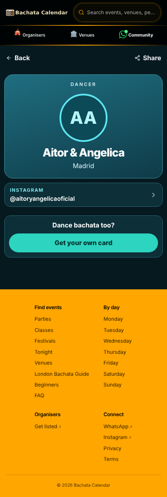 | 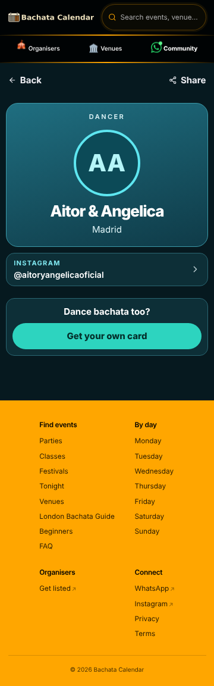 |
| dancer only, photo, city | `ben` | 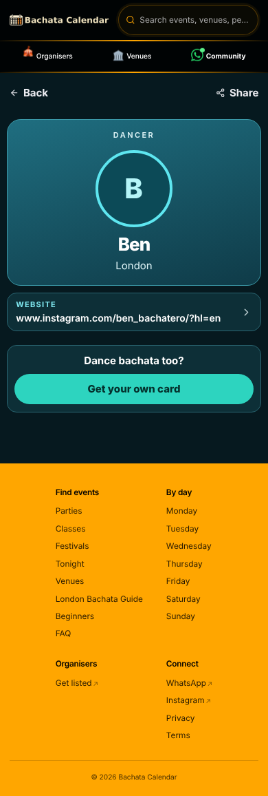 | 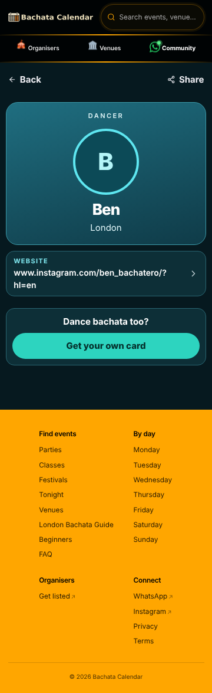 |
| dancer only, no photo, no city | `pao-pao-army` | 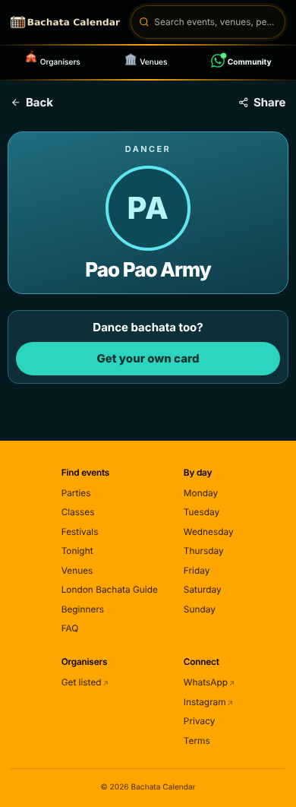 | 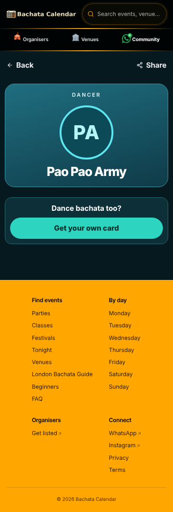 |
| dancer only, photo, no city | `florian` | 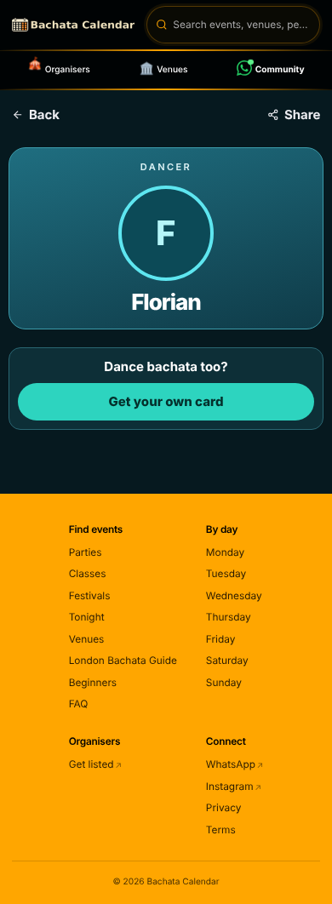 | 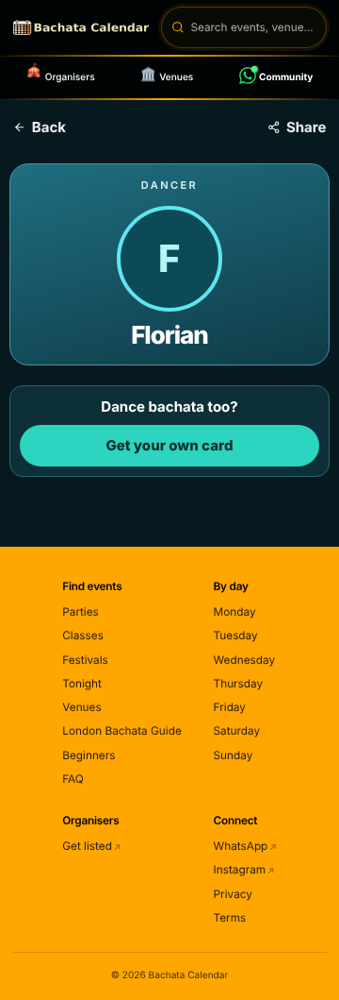 |
| teacher, dated (teacher pages closed in this build) | `alex-boneva` | 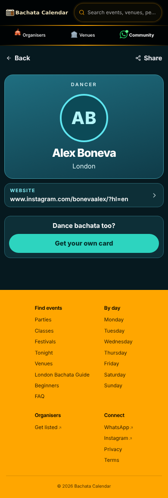 | 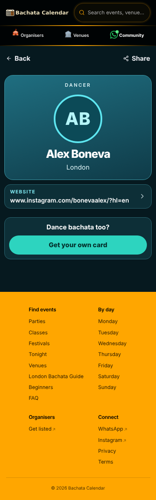 |
| teacher, no dates | `alexa-bzuk26` | 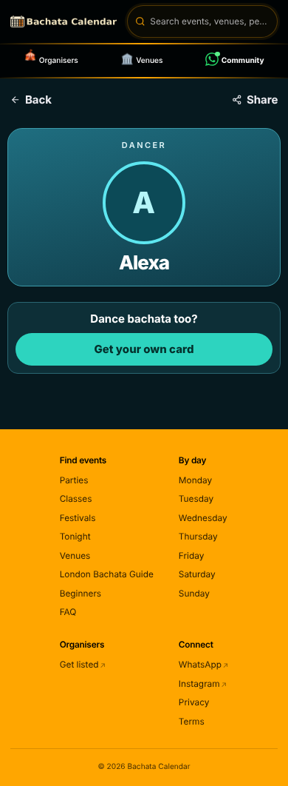 | 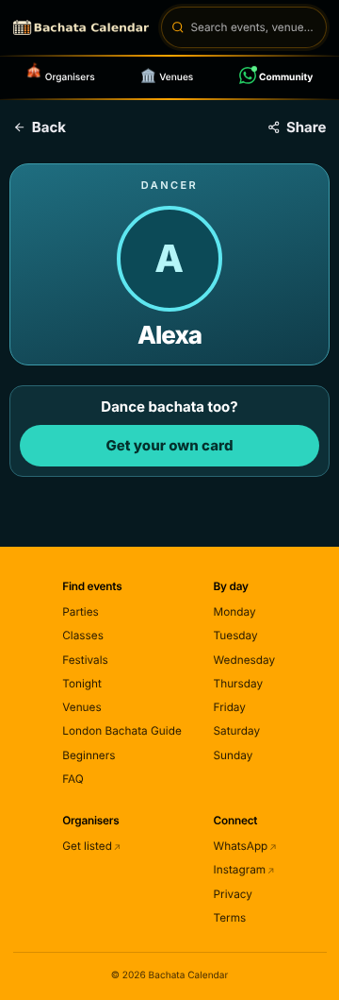 |
| DJ dated | `bobby-blanco` | 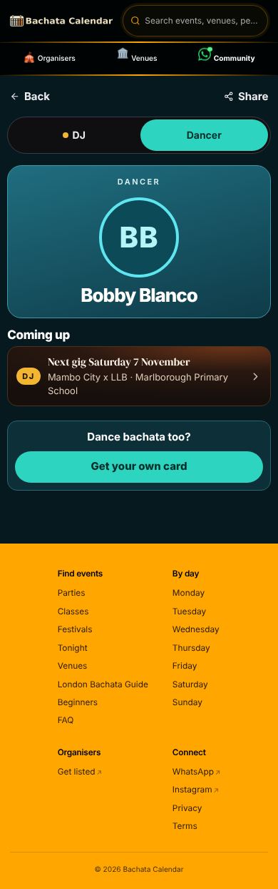 | 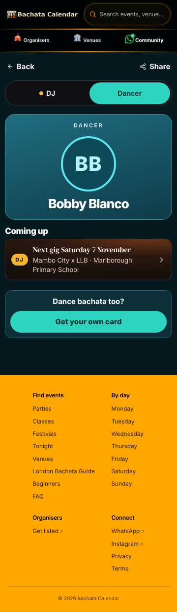 |
| DJ no dates | `brito` | 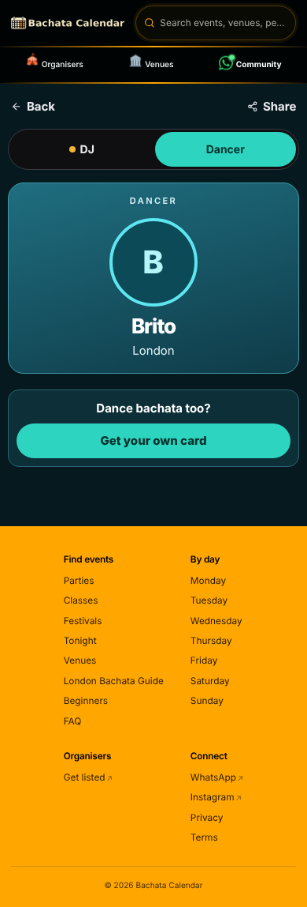 | 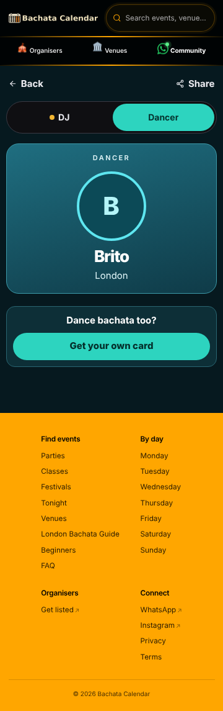 |
| DJ past only | `kal` |  |  |
| teacher + DJ dated | `b` | 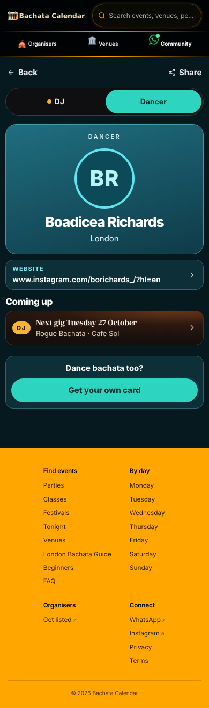 |  |
| teacher + DJ no dates | `john-otaran` | 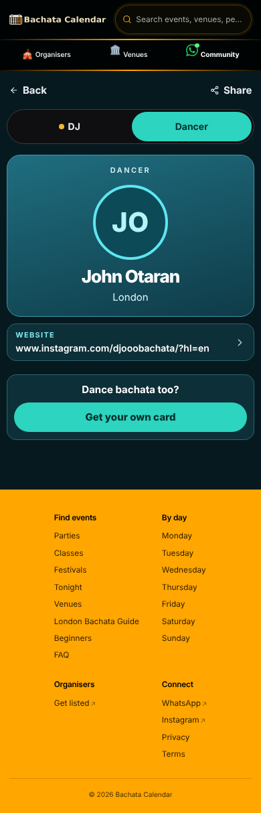 | 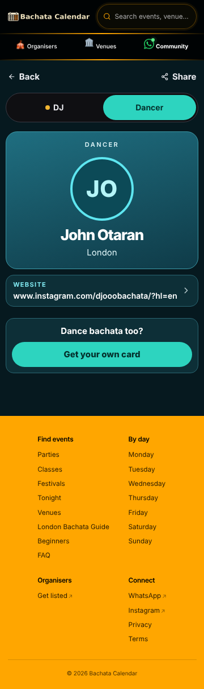 |
| teacher past + DJ dated, no photo, no city | `nickchata` | 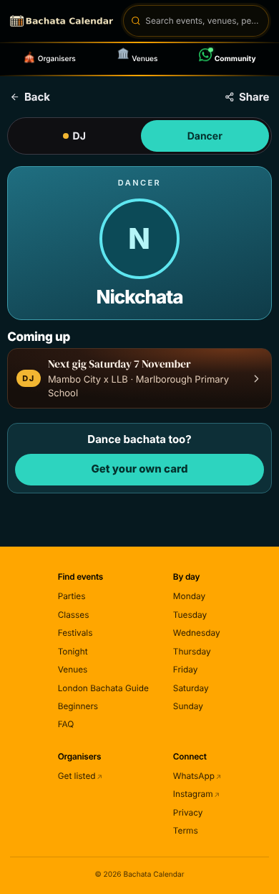 | 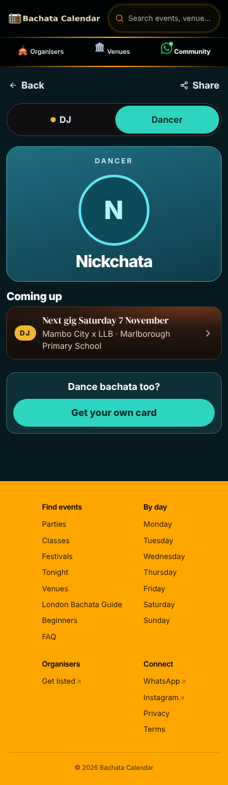 |

Every render: contrast >= 5.06, no tap under 44px, nothing clipped, no sideways scroll, invite last, no filler text.
Shift numbers before/after are in the design record.

## Not verified

- Signed-in renders in a browser (no test account): matrix only.
- Teacher previews on screenshots: walked with teacher pages open (`checks-teacher.json`, numbers only, no shots).
- On a Vercel preview: not deployed by this worker (push builds it; the orchestrator flips the flag).
- Stage 5 critique: separate worker.
- Unit suite: `test:unit` shows 15 failures that fail identically on `main` in this sandbox (live-DB contract tests
  against the session's non-prod Supabase env, and `integrityCouldNotRun` fixtures).
