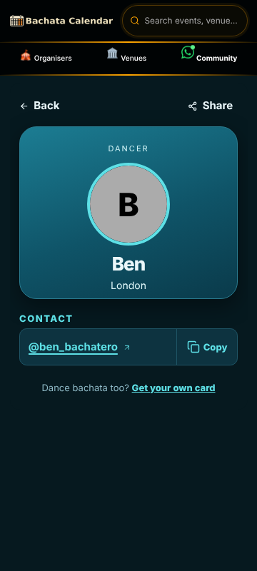
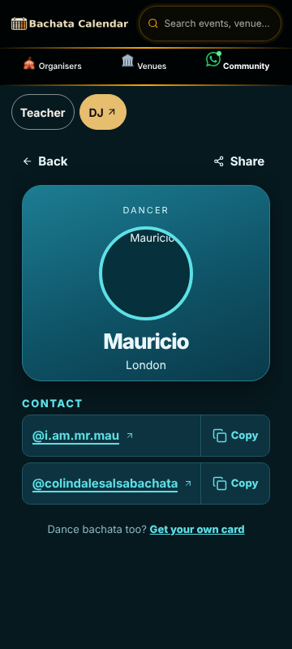
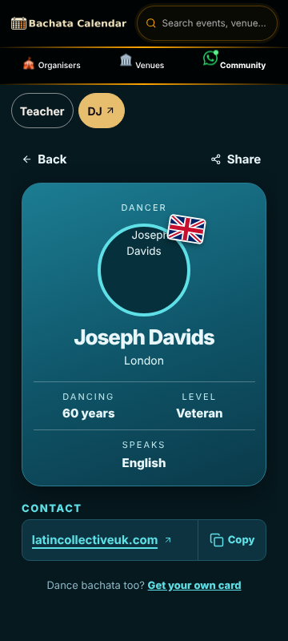
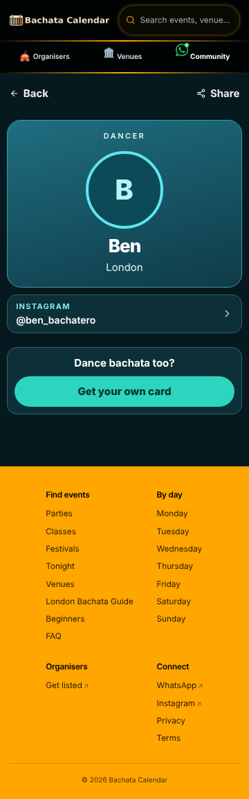
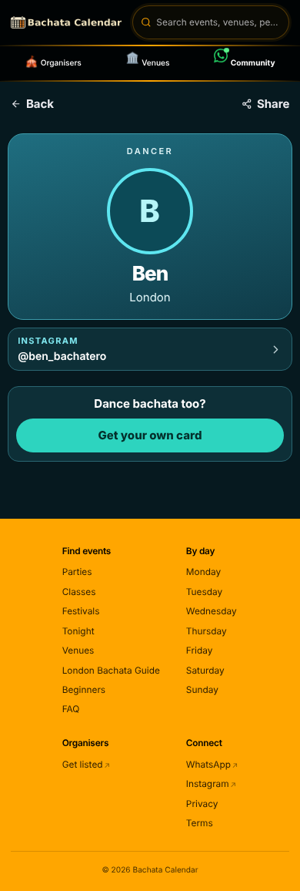
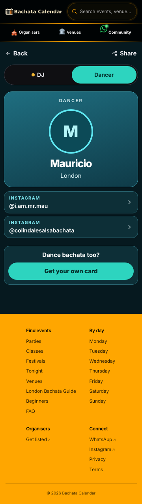
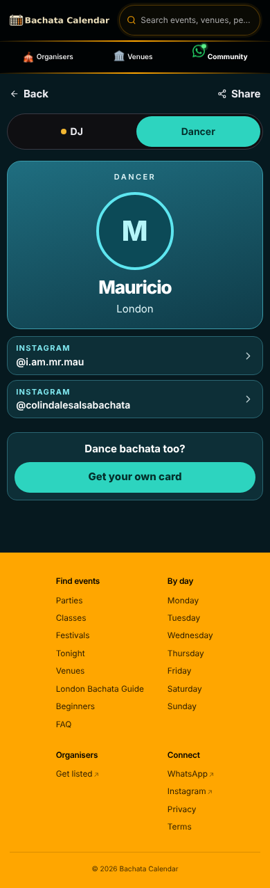

# People arc S8 -- website links that are really Instagram -- handover

- Branch: `claude/people-instagram-label` (from `main` 049f157). Brief: `briefs/PEOPLE-S8-instagram-label-brief.md`
  on `brief/people-arc`. Head: the last commit on the branch (`git log -1 origin/claude/people-instagram-label`);
  this file is in that commit. PR: opened by the repo bot (bot-pr.yml) on the push; the number is in the worker's final report.
- Design record: [`DESIGN.md`](DESIGN.md). It lives here, not in `docs/design/`, because this PR changes `src/modules/dancer-app/` and the `dancer-area-isolation` job (rule (a)) only allows doc changes under `docs/handover/`, `docs/journeys/`, `docs/review-pack(s)/` and `docs/people-arc/`.
- Lane: normal. No SQL, no migration, no RPC. Every changed source file is inside `src/modules/dancer-app/`.

## Ready-to-paste PR body

### Summary

Some dancers stored an Instagram URL as their website, so the contact row read
`WEBSITE www.instagram.com/ben_bachatero/?hl=en`. It now reads `INSTAGRAM @ben_bachatero`.
- `websiteContact` in `src/modules/dancer-app/public-page/model.ts` is the one mapping. It feeds both
  the flag-OFF dancer page and the dancer world (`WorldContact`, through `DancerProfile.tsx`).
- An instagram.com profile URL (bare, `www.` or `m.`) becomes an Instagram row labelled `@handle`.
  A facebook.com profile URL becomes a Facebook row. Posts, reels, `/explore`, `profile.php` and
  groups stay website rows: no handle is guessed from them.
- If the dancer's own Instagram (or Facebook) link shows the same handle, they get one row, not two.
  A different handle gets its own row.
- A website label never shows a scheme, `www.`, a query, a hash or a trailing slash. This uses
  `linkText`, the rule the DJ and teacher worlds already use. The href is always the stored URL.
- With the flag OFF, only the row label and kind change.

## Verified on real data

- Shapes surveyed: prod `stsdtacfauprzrdebmzg`, read-only, counts only, 2026-10-24.
  `dancer_profiles` has 191 rows and 58 non-empty websites: 47 instagram.com (0 post/reel, 0 `m.`),
  1 facebook.com (profile-shaped), 10 other sites, 43 with a query or hash, 0 malformed, 0 `http://`,
  1 with uppercase. 6 dancers have both a website and an Instagram link. In 3 of those the website is
  Instagram: 2 with the same handle, 1 with a different handle. `djs` has 0 rows. `entities.website` has
  1 value: not Instagram, no query. The teacher and DJ worlds show it through `linkText`, so they
  are unchanged.
- Checks run: the new table-driven `websiteContact.test.ts` (24 cases) was red first against the unfixed code
  (14 failed) and is now green. `src/modules/dancer-app/public-page` (228 tests) is green. The full
  `vitest run` is green apart from env-only failures that also fail on `main` (live-DB contract tests,
  `integrityCouldNotRun`) and two load timeouts (`festivalClientState`, `auth.today`) that pass alone.
  These all passed: `npm run lint` (22/22 links), `check:rpc-typing`, `check:wallclock-brand`,
  `check:legacy-tables`, `check:legacy-program-rpcs`, `lint:architecture`, `check-integrity.sh`,
  `AUDIT_STRICT=1 check:images`, the plan-hygiene, mojibake, bundle-budget, first-load-requests and
  chunk-cycles self-tests, `build` + `check:bundle-budget` + `check:first-load-requests` (all pins equal)
  + `check:chunk-cycles`. `test:e2e`: 160 passed, 2 skipped, 3 failed under load
  (`account-settings` x2, `home-nights` upcoming-going). All 3 pass alone on this branch and on `main`.
- NOT verified: the Vercel preview (the SSO wall: the walk ran on a local production build against prod
  data instead); Lighthouse (`check:lighthouse`); the live-DB `db-contract-check` steps (no change to the DB);
  a real phone.

## Phone QA

- Sizes checked: 390x844 and 360x800, on a local production build (`_serve-build.mjs`) reading prod data, once
  with the person-worlds flag off (the flag-OFF dancer page) and once with `VITE_ENABLE_PERSON_WORLDS=true`
  (the dancer world).
- Walked: `ben`, `alex-boneva`, `john-otaran`, `b` (Instagram stored as the website), `joseph-davids` (a real
  non-social website), `nadina-toso` (an Instagram website with the same handle as the Instagram link: one row),
  `mauricio` (a different handle: two Instagram rows) and `daniel-carbonero`. Every label fits on one line
  and no page scrolls sideways at either size.
- Not verified: a real phone; iOS Safari font rendering; the Vercel preview.

## Shapes walked

| Profile | Stored website shape | Row now (both pages) |
|---|---|---|
| ben, alex-boneva, john-otaran, b | instagram.com profile + `?hl=en` / `?igsh=` | INSTAGRAM `@handle` |
| joseph-davids | own site | WEBSITE `latincollectiveuk.com` |
| nadina-toso | instagram profile, same handle as the IG link | one INSTAGRAM row |
| mauricio | instagram profile, different handle | two INSTAGRAM rows |
| daniel-carbonero | instagram + facebook | INSTAGRAM + FACEBOOK |

## Shots

| | 360 | 390 |
|---|---|---|
| flag-OFF page, ben |  | |
| flag-OFF page, mauricio (two handles) |  | |
| flag-OFF page, joseph-davids (real site) |  | |
| dancer world, ben |  |  |
| dancer world, mauricio |  |  |

## CI jobs, run locally

| Workflow / job | Result |
|---|---|
| architecture-guard (integrity, legacy checks, lint:architecture, check:images strict, self-tests) | pass |
| typecheck (check:rpc-typing, check:wallclock-brand) | pass |
| perf-budget (build, bundle-budget, first-load-requests, chunk-cycles + self-tests) | pass. Lighthouse and doc-weight were not run. |
| lint chain (`npm run lint`) | pass, 22/22 |
| unit (`vitest run`) | pass, apart from the env-only failures listed above |
| e2e-smoke (`test:e2e`) | 160 passed, 3 load timeouts that pass alone |
| phone-qa / real-data-verified (PR-body checks) | depend on the PR body, so paste the sections above |
| db-contract-check | not run (live DB, no DB change) |
| unit-tests / dancer-area-isolation (`--self-test` + `check:dancer-area-isolation`) | pass (added by the S8 continuation; was red on CI) |
| unit-tests / `test:unit:timing` + the America/New_York and Australia/Sydney tz-sensitive legs | pass (added by the S8 continuation) |
| workflow-lint (docs-only self-test, workflow masking lint, notification lint self-test) | pass (added by the S8 continuation) |
| ci-budget-guard | self-test pass; the live check needs `CI_BUDGET_GITHUB_TOKEN` (not set locally), not run |
| seo-check | `check:seo:self-test` pass; `check:seo` needs the preview URL, not run |

## Left / follow-ups

- The DJ page's `splitInstagramWebsite` (`src/components/dj/djContacts.ts`) uses an older rule. It drops a
  non-profile Instagram website. It also drops an Instagram website whenever an Instagram link exists, even
  with a different handle. Making it match this rule is outside the dancer-app folder and outside this brief.
- A Facebook URL that is not profile-shaped (`profile.php?id=`, groups, pages) stays a website row with the
  cleaned label, as the brief asks. There are 0 such rows on prod today.

## S8 continuation

- What changed: `docs/design/people-s8-instagram-label.md` moved to `docs/people-arc/s8/DESIGN.md` (`git mv`),
  and the "Design record" link above now points at it. No other file referenced the old path. No source change;
  the allow-list and the isolation script are untouched.
- Why: CI job `dancer-area-isolation` (in `unit-tests.yml`) was red with one rule (a) violation: a dancer-area
  PR may only change docs under `docs/handover/`, `docs/journeys/`, `docs/review-pack(s)/` and `docs/people-arc/`.
  The builder's check table did not include that job; it is in the table now, with the other steps it missed.
- Check output (run on the branch after the move):
  - `node scripts/check-dancer-area-isolation.mjs --self-test` -> `self-test: 44 cases, all behave`
  - `DANCER_ISOLATION_BASE=origin/main node scripts/check-dancer-area-isolation.mjs` ->
    `base origin/main @ 049f1579a6; 11 changed file(s); 8 protected file(s) checked.` /
    `dancer-area PR: rules a+b+c` / `dancer-area isolation: OK`
  - `bin/check-integrity.sh` -> `integrity-guard: ok (2501 files checked, 0 issues)`
  - `npx vitest run src/modules/dancer-app/public-page` -> `Test Files 8 passed (8)`, `Tests 228 passed (228)`
  - `npm run test:unit:timing` -> 6 files, 65 tests passed; tz-sensitive leg under America/New_York and
    Australia/Sydney -> 9 files, 213 tests passed each
  - `docs-only.mjs --self-test` -> `42 cases, 20 mutants, ok`; `lint-workflow-masking.mjs` -> 33 files, clean;
    `lint-workflow-notification.mjs --self-test` -> pass; `check-ci-budget.mjs --self-test` -> 98 cases pass;
    `check:seo:self-test` -> 73 cases pass
- Owner call: should a dancer-app PR be allowed a `docs/design/` record? Recommendation: no; keep the allow-list
  as it is and keep each arc's design record under `docs/people-arc/<step>/`, so the isolation rule stays narrow.
- Verified: the isolation check is OK locally against `origin/main`, and the checks above pass.
- Not verified: the CI run on the new head (it starts on this push); the live `ci-budget-guard` check (no
  token); `check:seo` against the preview; everything the builder already listed as not verified.
